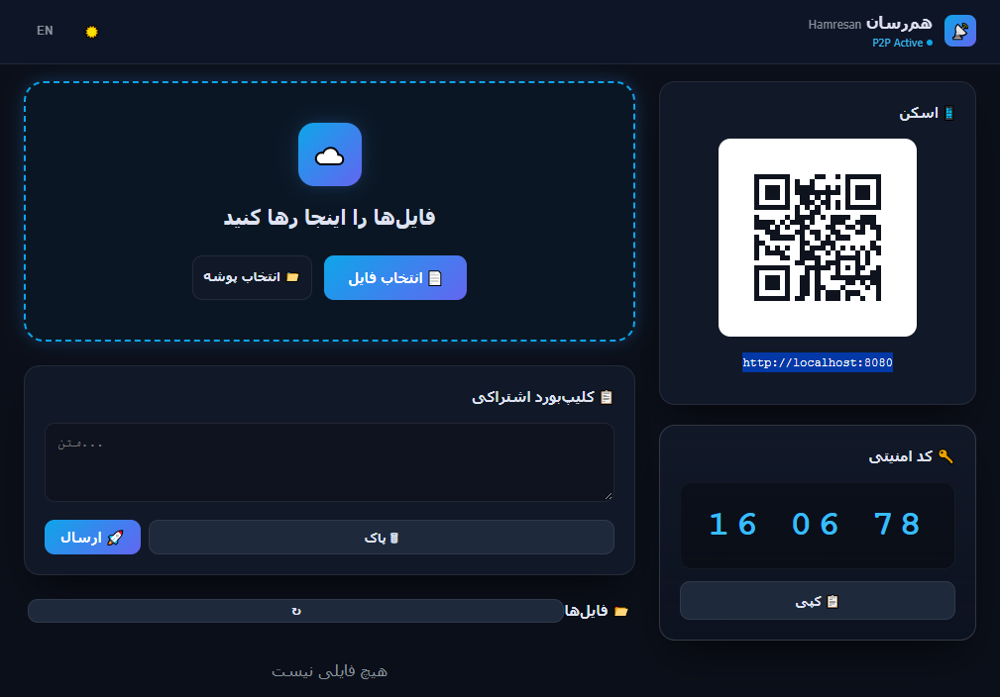
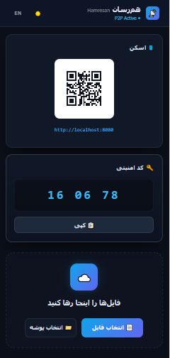

# Hamresan — هم‌رسان

> انتقال فایل روی شبکه محلی — بدون اینترنت، بدون سرور، بدون محدودیت حجم.

**Hamresan** lets you share files and text between devices on the same local network (Wi-Fi, hotspot, LAN) using a fast web interface. No cloud, no account, no size limit.

## 📸 اسکرین‌شات‌ها

  

  
  

## ✨ ویژگی‌ها

- 📁 انتقال فایل و پوشه با حجم نامحدود
- 📋 اشتراک متن و لینک (clipboard)
- 🔐 محافظت با PIN (فقط برای دستگاه‌های متصل به شبکه)
- 🌐 بدون نیاز به اپلیکیشن — فقط مرورگر
- 📱 کار روی اندروید، آیفون، ویندوز، مک، لینوکس
- 🖥️ اپلیکیشن دسکتاپ برای ویندوز (سیستم تری)
- 🌓 تم تاریک/روشن
- 🌍 دو زبانه (فارسی / انگلیسی)

## 📦 نصب

### دانلود فایل اجرایی (ویندوز)
از [Releases](https://github.com/MrBineery/Hamresan/releases) آخرین نسخه را دانلود کنید.

## 🚀 استفاده

۱. `hamresan.exe` را اجرا کنید.
۲. آدرس نمایش داده شده را روی گوشی باز کنید (یا QR را اسکن کنید).
۳. PIN را وارد کنید و فایل یا متن را به اشتراک بگذارید.

## 🛠 تکنولوژی

- **Rust** — هسته و سرور (Axum)
- **Svelte 5** — رابط کاربری مدرن و سریع
- **Tao + Wry** — پنجره دسکتاپ
- **CSS3 & HTML5** — استایل‌دهی

---

## 💬 انتقاد و پیشنهاد

اگر ایده، انتقاد یا پیشنهادی داری، خوشحال می‌شوم بشنوم! می‌تونی از طریق تلگرام بهم پیام بدی:

  

  ساخته شده با ❤️ توسط <b>SajjaD</b>

## 📄 لایسنس

MIT